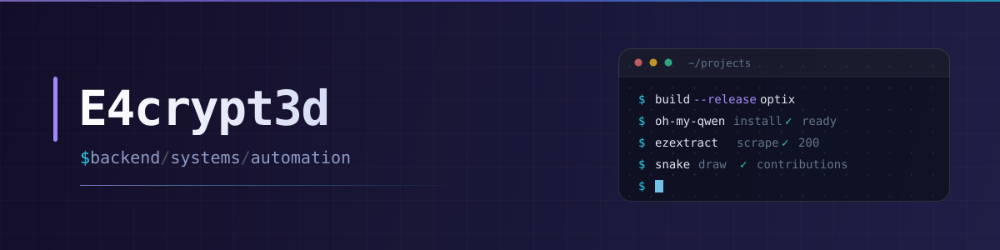

  

   

  <h3>Building practical tools in <code>Python</code>, <code>Rust</code> and <code>TypeScript</code>.</h3>

  
Backend systems, desktop tooling and scraping infrastructure — shipped, not just started.

  

    
    
    
  

---

## About

Most of what I build starts as a small annoyance and ends up as a tool other people use.

- **Backend** — Django, Channels, Celery, Flask, Fastify and SQLAlchemy. Real auth, real migrations, real load.
- **Desktop & systems** — Rust + Tauri apps that talk to Win32 directly: Raw Input, ViGEmBus, system APIs.
- **Scraping & automation** — `httpx` with automatic Playwright fallback, pagination, rate limiting and structured exports.

Right now I'm going deeper on async Rust and LLM agent tooling.

Tabs over spaces.

---

## Featured work

  
  

   

  
  

   

  
  

    

  <a href="https://github.com/E4crypt3d?tab=repositories"><b>Browse all 36 public repositories →</b></a>

---

## Stack

**Languages**

**Backend**

**Frontend**

**Systems**

**Data & tooling**

---

## Stats

  
  

   

  

   

  <picture>
    <source media="(prefers-color-scheme: dark)" srcset="https://raw.githubusercontent.com/E4crypt3d/E4crypt3d/output/github-contribution-grid-snake-dark.svg" />
    <source media="(prefers-color-scheme: light)" srcset="https://raw.githubusercontent.com/E4crypt3d/E4crypt3d/output/github-contribution-grid-snake.svg" />
    
  </picture>

---

## Contact

- ⭐ **Star** a repo if it saved you time
- 🐛 **Open an issue** — bugs and feature requests welcome
- 🍴 **Fork** it and build something better

E4crypt3d — tabs over spaces, always.
